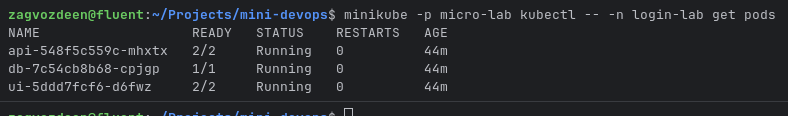
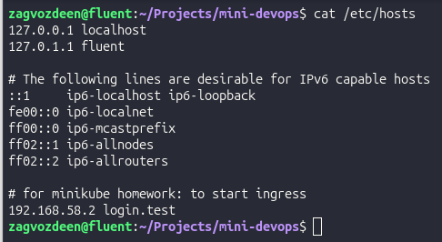
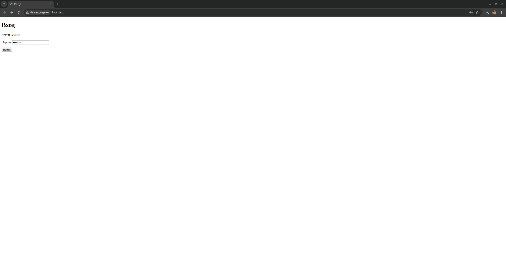

# Развертывание кластера minikube

Так совпало, что как раз на работе в Яндексе разрабатываю свой Service Mesh в k8s, поэтому с темой Istio очень хорошо знаком.
Это аналог, на который мы ориентируемся, когда пишем свой Service Mesh для других команд: агент, Control Plane, метрики, Data Plane.

В этой работе написал очень простой бэкенд на Java, который лежит в папке `api/`.
И написал супер простой фронтенд в папке `ui/`.
Это приложение запаковал в Dockerfile, чтобы его же запускать в контейнере.
В первом поде развернул API, во втором UI, а в третьем базу данных PostgreSQL
И настроил Ingress, NetworkPolicy и mTLS между сервисами через Istio.

## Как запустить локально

**Первое.** Запустить кластер, Ingress и Istio:

1. `minikube -p micro-lab start --driver=docker --cpus=2 --memory=4096 --cni=calico`
2. `docker update --cpus 2 micro-lab`
3. `minikube -p micro-lab addons enable ingress`
4. `istioctl install --context micro-lab --set profile=minimal -y`

**Второе.** Собрать образы:

1. `minikube -p micro-lab image build -t lab-ui:v1 ui`
2. `minikube -p micro-lab image build -t lab-api:v1 api`

**Третье.** Развернуть приложение:

1. `minikube -p micro-lab kubectl -- -n login-lab apply -f k8s/namespace.yaml`
2. `minikube -p micro-lab kubectl -- -n login-lab create secret generic db-password --from-literal=password=lab-pass`
3. `minikube -p micro-lab kubectl -- -n login-lab apply -f k8s/`
4. `minikube -p micro-lab kubectl -- -n login-lab wait --for=condition=Available deployment --all --timeout=5m`

Должны появиться поды:

## Как я проверял у себя

Сначала я узнал IP кластера командой `minikube -p micro-lab ip`. У меня это был `192.168.58.2`.
Далее добавил этот IP в `/etc/hosts`, написал строку `192.168.58.2 login.test`, чтобы открыть страницу по имени из правила Ingress:

Затем открыл `http://login.test/` в браузере и ввел логин `student` и пароль `demo-pass`:

Этого пользователя создал при создании базы данных. В файле [db.yaml](./k8s/db.yaml) это можно увидеть.

Далее нажал "Войти", и появилось сообщение "Вход выполнен":

Затем вернулся к форме, оставил тот же логин и ввёл другой пароль. На этот раз получил сообщение "Неверный логин или пароль":

По итогу трафик у нас идет сначала в Ingress, затем на поде попадает в Istio, где под капотом работает Envoy.
Если проследить один запрос, то при открытии `http://login.test` Ingress направляет его в под UI, где Envoy передаёт запрос Java-приложению.
Оно возвращает браузеру форму входа.

Когда я нажимаю "Войти", запрос снова доходит до UI. Дальше UI отправляет `POST /login` в API.
Между этими двумя подами Envoy устанавливает соединение с mutual TLS, а на стороне API проверяет по правилу Istio, что запрос пришёл от сервисной учётной записи UI.
После этого API обращается к PostgreSQL, где введенный пароль сверяется с сохранённым хешем.
